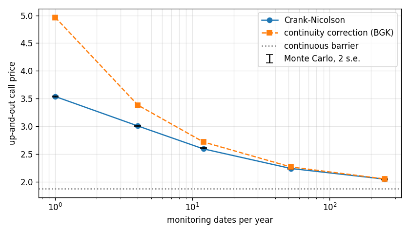

# pde-option-pricer

[](https://github.com/aakashbansalgit/pde-option-pricer/actions/workflows/tests.yml)

Crank-Nicolson option pricing that converges at second order for European, American and barrier options, and agrees with exact quadrature to within 0.0025 for barriers checked on discrete dates.


A Crank-Nicolson solver for the Black-Scholes PDE that prices European, American and barrier options, and a study that checks every case against an independent answer. It started as my final project for Numerical Methods in Finance at the University of Illinois, a single notebook, which I rewrote as a package after finding a sign error in how its boundary values entered the solve.

## The solver

`fdm/crank_nicolson.py` steps the PDE backwards from the payoff on a uniform price grid, with a Thomas solve at each step. Four details decide whether it is accurate:

- **Rannacher start.** Crank-Nicolson is second order but does not damp its highest-frequency error, so the kink in the payoff rings through the solution. The first steps are taken fully implicit, and the same restart follows every discrete barrier date, since each knock-out is a new jump.
- **Barrier placement.** A continuous barrier has to be the edge of the grid. A barrier checked on dates is the opposite case and belongs halfway between two nodes.
- **Monitoring dates on the time grid.** Every date is a time node. Knocking out even one step early behaves like an extra monitoring date and adds an error that only shrinks with the square root of the time step.
- **Early exercise.** For American puts the solver uses the Brennan-Schwartz algorithm, which solves the exercise problem exactly at each step inside the tridiagonal solve. The simpler projection, taking the maximum with the payoff after each step, is kept for comparison.

`fdm/closed_form.py` has Black-Scholes, the single-barrier formulas and the Broadie-Glasserman-Kou continuity correction.

## What the study shows

`python study.py` writes every table to `results/` and every chart to `figures/`. Errors below are model price minus the reference, with the same number of price and time steps.

European call against Black-Scholes, S = K = 100, r = 5%, sigma = 20%, one year:

| Steps | 100 | 200 | 400 | 800 | 1,600 |
|---|---|---|---|---|---|
| Error | -0.0399 | -0.0099 | -0.0025 | -0.00062 | -0.00015 |

The error falls by a factor of four each time the grid doubles, which is second order.

Up-and-out call with a continuous barrier at 120, against the closed form 1.8785:

| Steps | 100 | 200 | 400 | 800 | 1,600 |
|---|---|---|---|---|---|
| Barrier on the grid edge | -0.0030 | -0.00075 | -0.00019 | -0.000047 | -0.000012 |
| Barrier between nodes | -0.0108 | 0.0329 | 0.0418 | 0.0403 | 0.0350 |

With the barrier off the grid, refining makes no difference. The error stays near 0.04 however fine the grid gets.

American put, K = 100, sigma = 16%, one year, against a 20,000-step binomial tree (4.6009):

| Steps | 100 | 200 | 400 | 800 |
|---|---|---|---|---|
| Brennan-Schwartz | -0.0579 | -0.0149 | -0.0038 | -0.0010 |
| Projection | -0.0616 | -0.0174 | -0.0050 | -0.0016 |

The exact solve keeps second-order convergence. Projection loses it, and at 800 steps its error is 70% larger. `figures/exercise_boundary.png` traces the spot below which exercise is optimal, from about 86 a year out to 95 a week before expiry.

Up-and-out call checked on a fixed number of dates a year, against three independent answers: exact quadrature of the lognormal transition density, a million-path Monte Carlo, and the Broadie-Glasserman-Kou approximation:

| Dates | PDE | Quadrature | Monte Carlo | BGK |
|---|---|---|---|---|
| 1 | 3.5385 | 3.5385 | 3.5381 ± 0.0055 | 4.9645 |
| 4 | 3.0079 | 3.0092 | 3.0101 ± 0.0051 | 3.3841 |
| 12 | 2.5955 | 2.5976 | 2.6035 ± 0.0047 | 2.7200 |
| 52 | 2.2424 | 2.2447 | 2.2366 ± 0.0043 | 2.2700 |
| 252 | 2.0497 | | 2.0470 ± 0.0041 | 2.0530 |
| continuous | 1.8785 | | | 1.8785 |

The PDE agrees with quadrature to within 0.0025 at every frequency. The continuity correction is excellent for daily monitoring and badly wrong for a handful of dates, which is when you need the PDE.

A down-and-in put on the S&P 500 with spot at 5,650.38, strike 5,600 and the barrier at 5,500, 0.21 years out, sigma 17% and r 4.33%. The PDE prices the vanilla and the knock-out, and in-out parity gives the knock-in: 127.8816 against 127.8814 from the closed form. With the barrier this close to spot nearly all of the put's value is in the knock-in, and the knock-out is worth only 0.22.

`figures/gamma_rannacher.png` shows the problem the Rannacher start solves: a week before expiry, on a fine price grid with large time steps, plain Crank-Nicolson puts a spike of 0.68 and negative dips into the gamma of an at-the-money call. With the restart it is a smooth 0.147, against 0.144 from the formula.

## Running it

```
pip install numpy scipy pandas matplotlib
python -m pytest tests          # or: python tests/test_fdm.py
python study.py                 # about two and a half minutes
```

`tests/test_fdm.py` checks Europeans with dividends at three spots, second-order convergence, both barrier directions, the American put against a binomial tree, discrete monitoring against quadrature, and the S&P 500 knock-in by parity.
